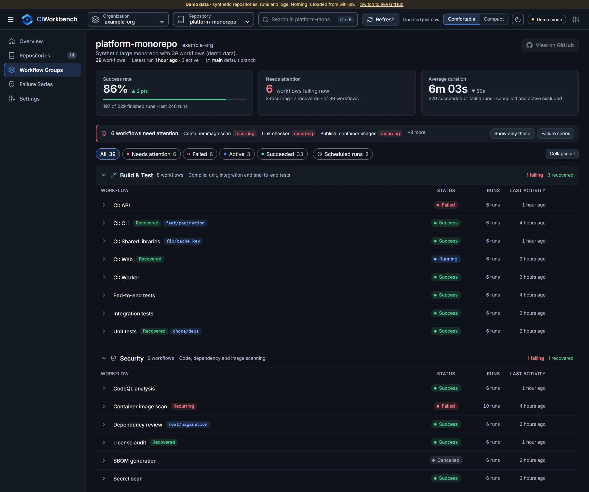
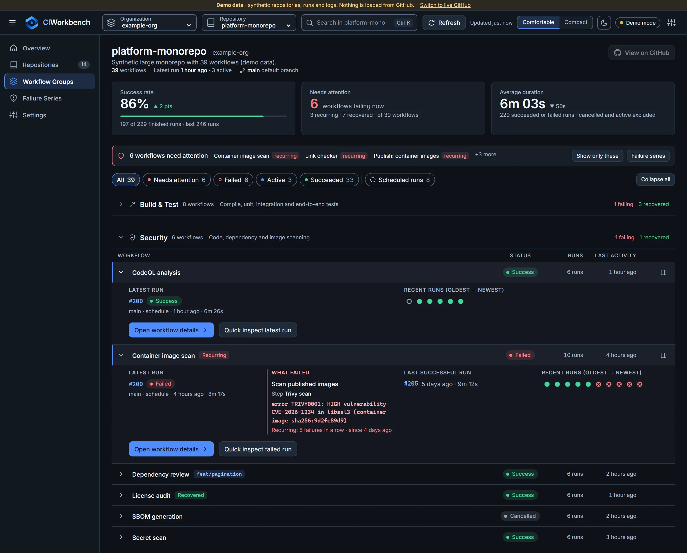
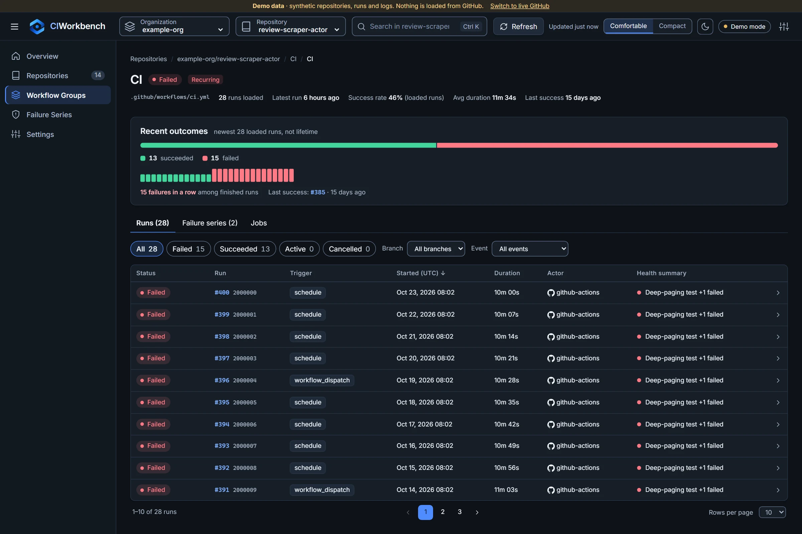
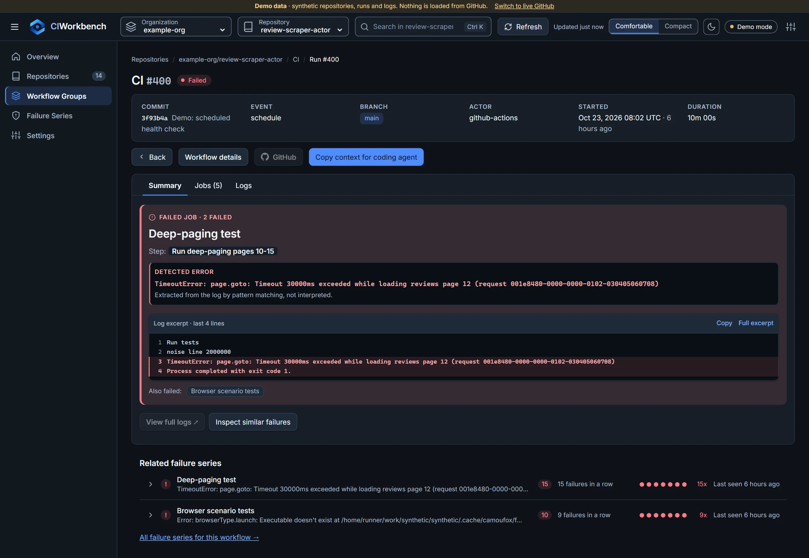
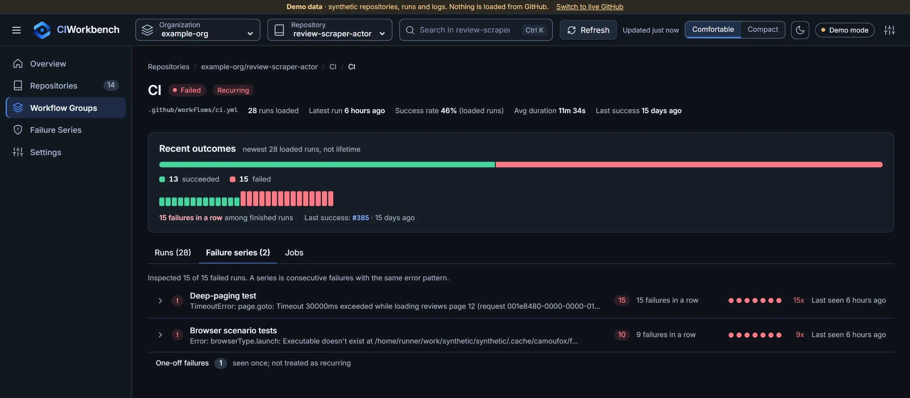
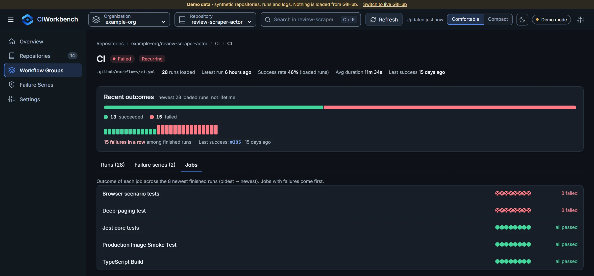

# CIWorkbench

**Your CI/CD workspace.**

Organize GitHub Actions workflows, monitor repository health and diagnose recurring CI failures from one interface. Built with .NET 10 and Blazor. Useful without AI.

> Status: hackathon MVP, run locally (there is no hosted instance). See [what is implemented vs. planned](#status).



*All screenshots are real captures of the built-in demo mode, which uses fully synthetic data.*

## Why CIWorkbench?

GitHub Actions lists workflows flat and per run. With 40 workflows that is hard to navigate, and with a nightly job that keeps failing you cannot see *what* keeps failing. CIWorkbench adds:

- **Workflow groups** from a central `.github/ciworkbench.yml` or a `# ci-workbench-group: Security` comment in the workflow file.
- **Clear status and repository health**: success rate, workflows needing attention, average duration.
- **Fast troubleshooting**: quick preview, workflow and run pages, on-demand logs, a detected error and the failing job and step.
- **Recurring failure series**: deterministic fingerprinting (workflow, job, failed step, normalized error signature) that shows streaks and separates unrelated errors in the same job.
- **Read-only GitHub integration**: a fine-grained token with read permissions, held server-side.

## Features

### Organized workflow workspace

Workflows are grouped and summarized per repository, with status filters and a "needs attention" summary on top.

### Diagnose failures without leaving the overview

Expand a workflow row to see its latest run, the failed job and step, the detected error and recent run outcomes. Open Workflow Details or the Quick Inspector from there.



### Understand workflow health and history

Recent Outcomes shows the success/failure distribution, the current failure streak and the last successful run above a filterable, paginated run history.



### Investigate failed runs

Run Details names the failing job and step, shows the error extracted from the log with a highlighted excerpt, and links related failure series. **Copy context for coding agent** produces a redacted, bounded summary that is never sent anywhere.



### Detect recurring failures

Failures are grouped by a normalized error signature rather than exit code, so two different errors in the same job stay separate and one-off failures are not reported as recurring.



### Inspect job-level history

The Jobs tab shows the outcome of every job across recent runs, so you can see which job is unhealthy without opening each run.



Also included: Light, Dark and System themes, Comfortable and Compact density, and responsive layouts down to phone width.

## Quick start (demo mode, no credentials)

Requires the [.NET 10 SDK](https://dotnet.microsoft.com/download).

```powershell
dotnet run --project src/CIWorkbench.Web --urls http://localhost:5290
```

Open <http://localhost:5290>: it goes straight to the workflow workspace of a synthetic 39-workflow monorepo. Demo mode uses fully synthetic data (that monorepo and a scraper actor with recurring failure series) and is labelled as such. No token or network access to GitHub is needed.

Routes, responsive behaviour and how to try the demo on a phone: [docs/development/responsive-and-mobile-testing.md](docs/development/responsive-and-mobile-testing.md).

Colour tokens, Light/Dark/System theming and the visual, accessibility and theme test tooling: [docs/development/design-system.md](docs/development/design-system.md).

How the screenshots above are regenerated: [docs/development/readme-screenshots.md](docs/development/readme-screenshots.md).

## Live GitHub (read-only)

Create a **fine-grained personal access token** with *read-only* `Metadata`, `Actions` and `Contents` permissions (details: [docs/development/github-permissions.md](docs/development/github-permissions.md)), then supply it **server-side**:

```powershell
dotnet user-secrets set "GitHub:Token" "<token>" --project src/CIWorkbench.Web
$env:CIWORKBENCH_MODE = "live"   # optional; otherwise switch in Settings
dotnet run --project src/CIWorkbench.Web --urls http://localhost:5290
```

The token is never sent to the browser and never stored in `localStorage`. The standalone host is **single-user and meant for localhost** ([SECURITY.md](SECURITY.md)).

## Two ways to start it

**1. Standalone (default, nothing else required):**

```powershell
dotnet run --project src/CIWorkbench.Web --urls http://localhost:5290
```

**2. Through .NET Aspire (optional: adds the Aspire Dashboard with structured logs, traces and metrics):**

```powershell
dotnet run --project src/CIWorkbench.AppHost
```

The AppHost starts only the web app and the dashboard. It needs **no** Docker, database, cache or other infrastructure, and demo mode works exactly as it does standalone. To use live GitHub data through the AppHost, store the token as an AppHost user secret (never in a file that is committed):

```powershell
dotnet user-secrets set "Parameters:github-token" "<fine-grained read-only PAT>" --project src/CIWorkbench.AppHost
```

Without that secret the web app starts in demo mode. Details, the metrics emitted, and what is deliberately never recorded: [docs/architecture/observability.md](docs/architecture/observability.md).

## Repository layout

```text
src/
  CIWorkbench.Core/        models, provider seam, grouping, filtering, failure series, demo data (no UI, no HTTP)
  CIWorkbench.GitHub/      read-only GitHub REST provider, credential seam, retry/rate limit/ETag
  CIWorkbench.Components/  reusable Razor class library (workspace, run table, inspector, failure series)
  CIWorkbench.Web/         standalone Blazor Server host (shell, session, onboarding)
  CIWorkbench.ServiceDefaults/  standard Aspire service defaults (OpenTelemetry, health checks); inert without an OTLP endpoint
  CIWorkbench.AppHost/     optional Aspire AppHost (dashboard + orchestration, no infrastructure)
tests/                     Core, GitHub (fake HTTP), Web (bUnit + HTTP smoke)
docs/                      architecture and development docs
```

Build and test:

```powershell
dotnet build CIWorkbench.slnx
dotnet test tests/CIWorkbench.Core.Tests; dotnet test tests/CIWorkbench.GitHub.Tests; dotnet test tests/CIWorkbench.Web.Tests
```

## Configuring groups

Add an optional **`.github/ciworkbench.yml`** to the repository's default branch (the legacy root `.ciworkbench.yml` is still read when the `.github` file does not exist; if both exist, `.github/ciworkbench.yml` wins and the legacy file is ignored). The first line is a [YAML Language Server](https://github.com/redhat-developer/yaml-language-server) directive that points your editor at the published schema, so you get validation and autocompletion without copying any file:

```yaml
# yaml-language-server: $schema=https://raw.githubusercontent.com/saas-factory-labs/ci-workbench/main/schemas/ciworkbench.schema.json
version: 1
groups:
  - name: Build & Test
    description: Compile and test
    workflows: [".github/workflows/ci.yml", ".github/workflows/*-tests.yml"]
  - name: Security/Scanning        # "/" nests groups
    workflows: [".github/workflows/codeql.yml"]
```

Precedence: **central config → `# ci-workbench-group:` comment → "Ungrouped"**. Workflows are matched by file path (never display name). A bad configuration never hides a workflow: problems are reported with line numbers (unknown fields, wrong types, paths that match nothing, workflows matched by several groups) and affected groups fall back to comments or "Ungrouped". `version` is optional (omitted means `1`). The schema URL works once `schemas/ciworkbench.schema.json` is on `main`. Full contract, messages and versioning policy: [docs/configuration/workflow-grouping.md](docs/configuration/workflow-grouping.md).

## Status

| Area | State |
|---|---|
| Demo mode, both fixtures, full UI | Implemented |
| GitHub PAT (server-side), read-only REST provider | Implemented, unit-tested against a fake HTTP server; **not yet exercised against live GitHub in CI** |
| Progressive discovery, cancellation, permission checks, rate-limit awareness | Implemented |
| Workflow groups, filters, density, Run Inspector, failure series, agent-context copy | Implemented |
| GitHub App auth, per-user repository authorization, hosted multi-user mode | Planned (interfaces only, see docs) |
| Azure DevOps / other providers | Planned |
| Webhooks / push updates | Not planned for MVP (30 s polling) |
| Playwright browser tests in CI | Planned (browser scripts exist in `tests/visual` and run manually; they are not part of CI) |

## Contributing / License

See [CONTRIBUTING.md](CONTRIBUTING.md), [SECURITY.md](SECURITY.md) and [HACKATHON.md](HACKATHON.md). Licensed under [Apache-2.0](LICENSE).

